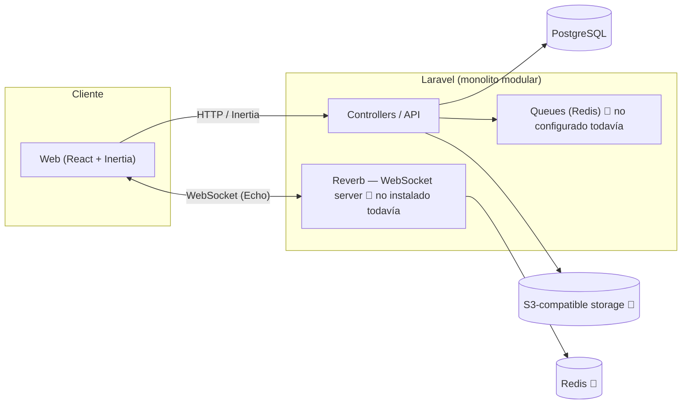
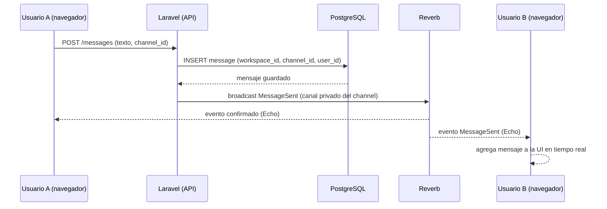

# Arquitectura

## Estilo: monolito modular

Laravel + Inertia + React en un solo despliegue, sin microservicios. Justificación: un solo desarrollador (semi-senior en aprendizaje), escala esperada de cientos a bajos miles de usuarios concurrentes, y el objetivo es aprender y **enviar** algo funcional — separar en servicios agregaría complejidad operativa (deploy, observabilidad, comunicación entre servicios) sin un beneficio real a esta escala.

## Diagrama de alto nivel



> 🔲 = todavía no instalado/configurado en el código — ver `SETUP.md` para el estado real.

## Diagrama de secuencia — enviar un mensaje (diseño objetivo, feature aún no construida)



## Multi-tenancy: schema compartido con `team_id`

Decisión bloqueada (ver `CLAUDE.md` 2.1): schema compartido, no schema-per-tenant. En el código el campo se llama `team_id` (el starter kit usa "Team"; conceptualmente es el `workspace_id` del producto). Toda tabla tenant-scoped nueva (`channels`, `messages`, `direct_conversations`, etc.) debe llevar `team_id` de forma directa o heredada de su padre (ej. `messages` hereda el scope a través de `channel_id` → `channels.team_id`).

**Patrón de scoping:** el starter kit ya resuelve el team actual vía el segmento de URL `{current_team}` (ver `routes/web.php`) y el middleware `SetTeamUrlDefaults` — cualquier query de un modelo tenant-scoped debe filtrar por el team resuelto en esa request, nunca confiar en que el frontend mande el `team_id` correcto sin validarlo contra la membresía del usuario autenticado.

## Estructura de carpetas (backend)

Estado actual (heredado del starter kit, orientado a Auth/Teams — no domain-oriented todavía):

```
app/
├── Actions/         (Fortify, Teams)
├── Http/
│   ├── Controllers/ (Settings, Teams)
│   ├── Middleware/  (HandleAppearance, HandleLocale, SetTeamUrlDefaults, ...)
│   ├── Requests/
│   └── Responses/
├── Models/
├── Notifications/Teams/
├── Policies/
└── Providers/
```

**Propuesta para cuando se construya Mensajería/Canales (no aplicado todavía):** pasar a organización por dominio, ej. `app/Domain/Messaging/`, `app/Domain/Channels/`, siguiendo el mismo espíritu que `Teams/` ya tiene hoy — se evalúa cuando arranque esa fase, no antes (evitar reestructurar carpetas sin código real que las llene).

## Entornos y backups

- **Local:** Herd (sirve PHP) + PostgreSQL nativo instalado localmente (no Docker todavía — ver `SETUP.md`).
- **Staging/Producción:** no definido todavía — recomendación pendiente en `STACK.md` (VPS + Docker Compose o Laravel Forge, sin Kubernetes).
- **Backups de base de datos:** no configurado todavía. Recomendación: `pg_dump` programado + almacenamiento externo (S3-compatible) una vez exista un entorno real de producción — no es una prioridad mientras el proyecto está en desarrollo local.
