# Diagrama Entidad-Relación

> Convención: en el código el "Workspace" del producto se llama `Team` (viene del starter kit de Laravel). Este documento usa "Team/Workspace" indistintamente para dejarlo explícito.
> 🟢 = ya existe en el código · 🔲 = propuesto, no construido todavía (requiere aprobación antes de migrar)

```mermaid
erDiagram
    USER ||--o{ TEAM_MEMBER : "pertenece a"
    TEAM ||--o{ TEAM_MEMBER : "tiene"
    TEAM ||--o{ TEAM_INVITATION : "invita"
    USER ||--o{ TEAM_INVITATION : "invitó (invited_by)"
    TEAM ||--o{ JOIN_REQUEST : "recibe"
    USER ||--o{ JOIN_REQUEST : "solicita"
    USER ||--o{ SOCIAL_ACCOUNT : "vincula"
    TEAM ||--o{ CHANNEL : "contiene"
    CHANNEL ||--o{ CHANNEL_MEMBER : "tiene"
    USER ||--o{ CHANNEL_MEMBER : "es miembro de"
    CHANNEL ||--o{ MESSAGE : "contiene"
    USER ||--o{ MESSAGE : "envía"
    MESSAGE ||--o{ MESSAGE_ATTACHMENT : "adjunta"
    MESSAGE ||--o{ MESSAGE_REACTION : "recibe"
    USER ||--o{ MESSAGE_REACTION : "reacciona"
    MESSAGE ||--o{ MESSAGE : "responde a (thread)"
    USER ||--o{ DIRECT_CONVERSATION : "participa"
    DIRECT_CONVERSATION ||--o{ MESSAGE : "contiene"
    USER ||--o{ NOTIFICATION : "recibe"
    USER ||--o{ PASSKEY : "registra"

    USER {
        bigint id PK
        string name
        string email UK
        timestamp email_verified_at
        string password
        bigint current_team_id FK
    }

    TEAM {
        bigint id PK
        string name
        string slug UK
        boolean is_personal
        string domain "🔲 nullable, dominio del email del creador — usado para auto-join liviano MVP"
        timestamp deleted_at
    }

    TEAM_MEMBER {
        bigint id PK
        bigint team_id FK
        bigint user_id FK
        string role "owner|admin|member"
    }

    TEAM_INVITATION {
        bigint id PK
        string code UK
        bigint team_id FK
        string email
        string role
        bigint invited_by FK
        timestamp expires_at
        timestamp accepted_at
    }

    JOIN_REQUEST {
        bigint id PK "🔲 propuesto — MVP, auto-join liviano por dominio"
        bigint team_id FK
        bigint user_id FK
        string status "pending|approved|rejected"
        bigint reviewed_by FK
        timestamp reviewed_at
    }

    SOCIAL_ACCOUNT {
        bigint id PK "🔲 propuesto — requerido para Google OAuth"
        bigint user_id FK
        string provider "google"
        string provider_user_id
        timestamp created_at
    }

    CHANNEL {
        bigint id PK "🔲 propuesto — MVP"
        bigint team_id FK
        string name
        string type "public|private"
        bigint created_by FK
    }

    CHANNEL_MEMBER {
        bigint id PK "🔲 propuesto — MVP"
        bigint channel_id FK
        bigint user_id FK
    }

    MESSAGE {
        bigint id PK "🔲 propuesto — MVP"
        bigint channel_id FK "nullable si es DM"
        bigint direct_conversation_id FK "nullable si es canal"
        bigint user_id FK
        bigint parent_message_id FK "nullable — thread/reply, V2"
        text body
        timestamp edited_at "nullable"
        timestamp deleted_at "soft delete"
    }

    MESSAGE_ATTACHMENT {
        bigint id PK "🔲 propuesto — V2"
        bigint message_id FK
        string path
        string mime_type
        integer size_bytes
        timestamp purge_after "ventana de retención tras borrado"
    }

    MESSAGE_REACTION {
        bigint id PK "🔲 propuesto — V2"
        bigint message_id FK
        bigint user_id FK
        string emoji
    }

    DIRECT_CONVERSATION {
        bigint id PK "🔲 propuesto — MVP"
        bigint team_id FK
        timestamp created_at
    }

    NOTIFICATION {
        bigint id PK "🔲 propuesto — V2 (push web/mobile)"
        bigint user_id FK
        string type
        json data
        timestamp read_at
    }

    PASSKEY {
        bigint id PK "🟢 ya existe"
        bigint user_id FK
        string name
        json credential
        timestamp last_used_at
    }
```

## Diccionario de datos — notas clave

- **`team.domain`** (🔲 propuesto): se completa automáticamente con el dominio del email de quien crea el workspace (ej. `acme.com`). No se verifica propiedad del dominio en el MVP (eso es V2, vía registro DNS TXT) — es solo para poder sugerir "pedir unirse a este workspace" a alguien que se registre después con el mismo dominio.
- **`join_request`** (🔲 propuesto): registra la solicitud de un usuario para unirse a un workspace existente por coincidencia de dominio. Un admin del workspace la aprueba o rechaza — nunca es automático, para evitar que cualquiera con un email de dominio similar entre sin control.
- **`social_account`** (🔲 propuesto): vincula un `User` a su identidad de Google (u otro proveedor OAuth en el futuro). Un usuario puede tener cuenta local (password) y cuenta social vinculada simultáneamente.
- **`message.parent_message_id`**: auto-referencia para threads/replies — campo reservado desde el MVP en el diseño, aunque la feature de threads es V2, para no requerir una migración destructiva después.
- **Multi-tenancy:** todas las tablas tenant-scoped (`channel`, `message`, `direct_conversation`, etc.) llevan `team_id` (= `workspace_id` conceptual) de forma directa o a través de su canal/conversación padre — schema compartido, no schema-per-tenant (decisión bloqueada, ver `CLAUDE.md` 2.1).
